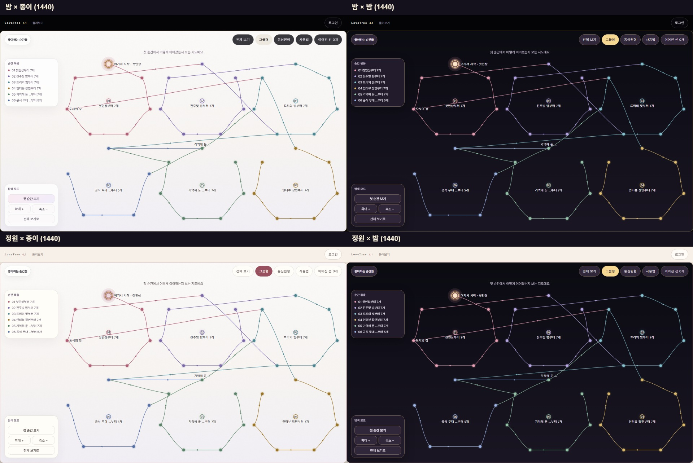
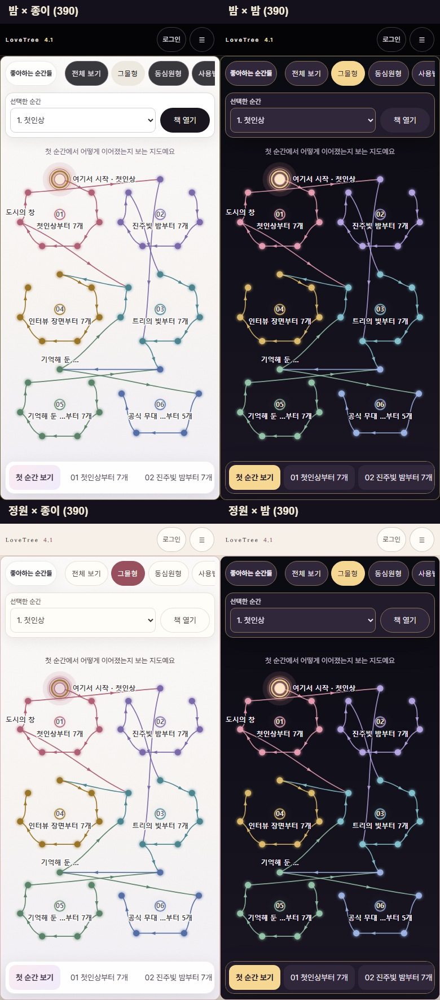
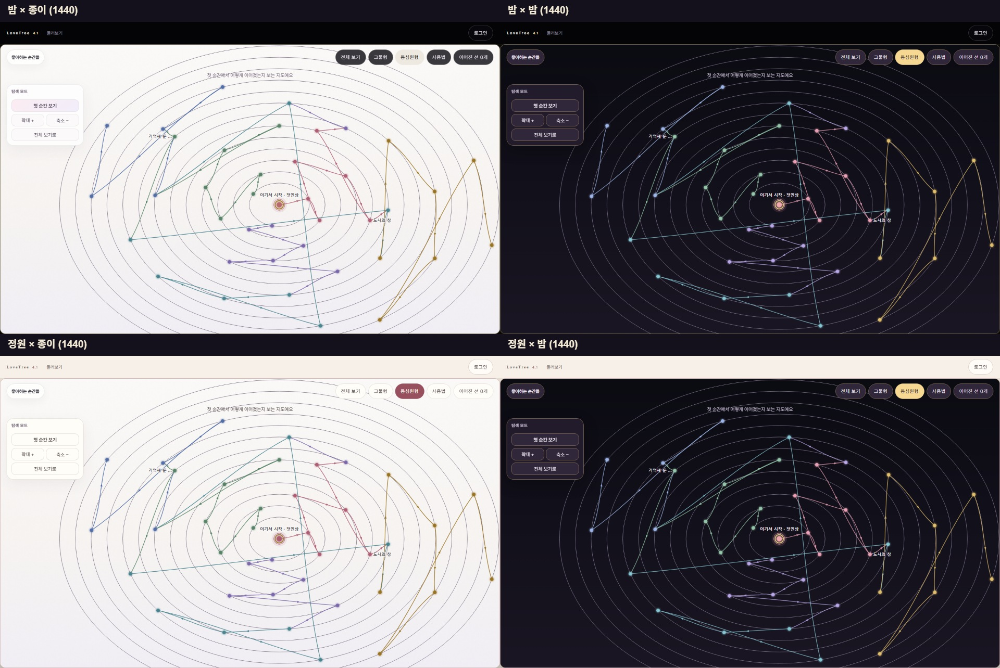
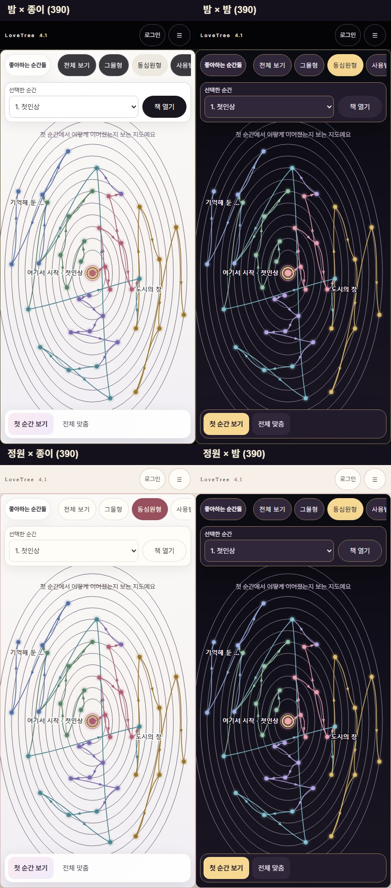
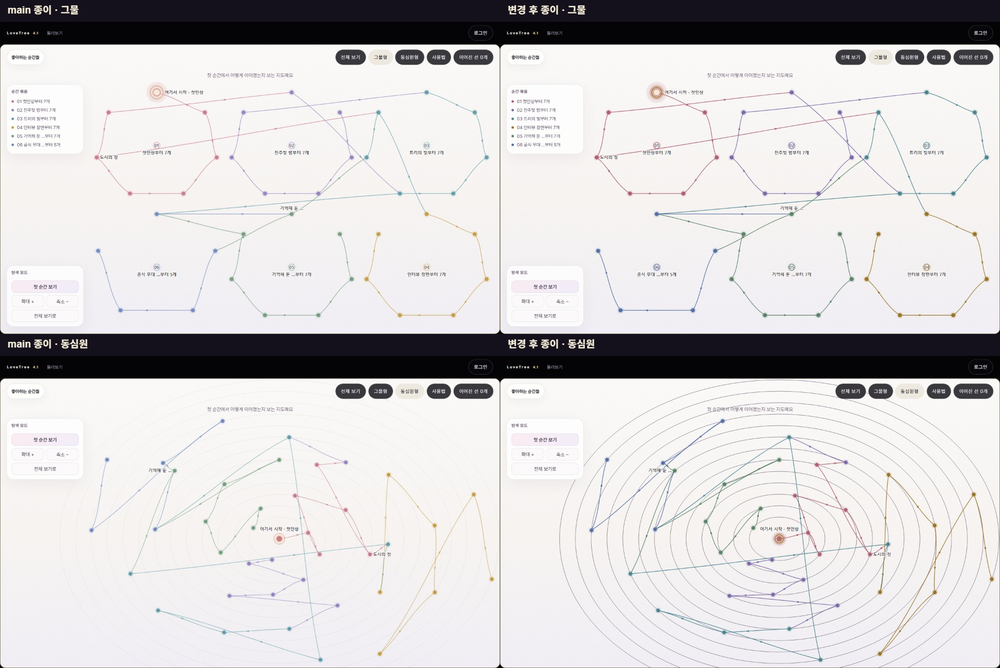
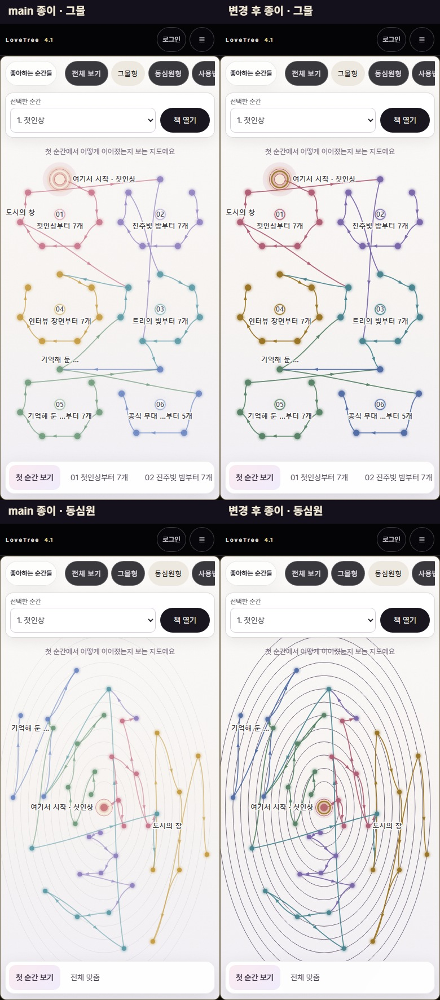

# 지도 판 종이 / 밤 — 화면 검증 (2026-11-13)

기존 설정 값을 함께 쓰는 **보드·지도 판**이다. 기본은 종이, 저장 키는 기존 `lt41.boardTheme`다. 셸의 `frameMessage('boardTheme', ...)`와 프레임 속성으로 알리고, 지도는 색 캐시를 비워 한 번 다시 그린다. 문서를 다시 띄우지 않는다.

## 비교 그림

각 그림의 위 행은 밤 앱, 아래 행은 정원 앱이다. 왼쪽은 종이 판, 오른쪽은 밤 판이다. 로그아웃 예시 트리 40순간을 사용했다.

## 실제 대비

Playwright Chromium, 1440×900·390×844, DPR 2. 앱 2 × 판 2 × 폭 2에서 그물 전체·순간 선택·묶음 선택, 동심원 전체·순간 선택 **40장면**을 쟀다. 창·글꼴·등장 연출이 끝난 뒤 캡처했다.

- DOM: `getComputedStyle` 글자색, 실제 바탕색·그라데이션·부모 투명도를 캔버스 바탕 픽셀 위에 합성한다. 도구 줄·묶음 목록·탐색·상세·안내·모바일 선택 줄을 포함한다.
- 캔버스: 그리기 훅은 글자와 도형의 **위치만** 기록한다. 색은 실제 캡처 PNG에서 읽는다. 글자는 동일 글꼴·한국어·불투명 캔버스의 글자 안쪽 마스크를 사용해 안쪽 픽셀 하위 10%를 잰다. 점은 색칠된 면/선택점 윤곽, 선·화살표·고리는 각 도형의 안쪽 단면 대표값을 쓴다. 가려진 부분과 앤티앨리어싱 가장자리는 제외한다. 색 토큰끼리 계산하지 않는다.
- 모든 보이는 측정 대상은 개별 행을 만든다. 필요한 역할이 없거나 안쪽 픽셀을 못 찾으면 실패한다. 각 아래 값은 해당 조합의 여러 장면·도형 중 최저다.

| 폭 · 앱 · 판 | DOM 글자 | 캔버스 글자·번호 | 점·첫 순간 | 선·화살표 | 단계 원·첫 순간 두 고리 |
|---|---:|---:|---:|---:|---:|
| 1440 · 밤 · 종이 | 5.06 | 6.73 | 3.09 | 3.41 | 3.63 |
| 1440 · 밤 · 밤 | 7.92 | 11.07 | 5.38 | 4.28 | 4.89 |
| 1440 · 정원 · 종이 | 5.60 | 6.73 | 3.61 | 3.44 | 3.68 |
| 1440 · 정원 · 밤 | 7.92 | 11.07 | 5.38 | 4.28 | 4.89 |
| 390 · 밤 · 종이 | 5.00 | 6.73 | 3.33 | 3.44 | 3.63 |
| 390 · 밤 · 밤 | 7.92 | 11.35 | 5.95 | 3.98 | 4.20 |
| 390 · 정원 · 종이 | 5.57 | 6.67 | 3.76 | 3.44 | 3.68 |
| 390 · 정원 · 밤 | 7.92 | 11.35 | 5.95 | 3.98 | 4.20 |

글자 기준 4.5:1, 비문자 기준 3:1. 역할별 색·바탕·최저값과 픽셀 차이는 [측정 JSON](measurements.json)에 있다.

## 기본 종이와 main의 차이

기준은 `9685f5c`(#510·#511 포함)이다. 같은 브라우저 버전·뷰포트·DPR 1·감소 모션·글꼴 대기·정지 상태에서 캡처했다. 첫 화면은 그물 전체 보기이며 동심원도 따로 비교했다.

**픽셀 차이 0 목표는 달성하지 못했다.** 바탕 그라데이션·점/묶음/이름표 좌표·글자 내용·#461 배치 계산은 그대로다. 색 토큰만 옮긴 중간 단계는 차이 0~0.0017%(채널 차이 16 초과 0%)였다. 최종 차이는 기존 대비 미달을 고친 색에서 난다.

- 기존 종이는 흐려진 번호 약 1.31~1.33:1, 이름표 2.34~2.35:1, 상세 보조 글자 2.26~2.30:1, 선 1.02:1, 안내 원 1.14:1, 첫 순간 안쪽 고리 1.03~1.05:1이었다.
- 점·선의 같은 계열 색을 조금 짙게 하고, 첫 순간 고리·안내 원과 흐려진 글자를 읽을 수 있게 했다. 점의 빛과 앤티앨리어싱 가장자리도 함께 달라진다. 작은 화면은 선이 차지하는 비율이 높아 차이율이 크다.
- 선택한 길은 묶음색과 기존 빛 효과, 나머지는 읽히는 중성색으로 구분한다. 예전의 극단적인 흐림은 대비 하한 때문에 유지하지 않는다.

| 폭 · 앱 · 보기 | RGB 한 채널이라도 다른 픽셀 | 채널 차이 16 초과 | main 연속 캡처 차이(픽셀) |
|---|---:|---:|---:|
| 1440 · 밤 · 그물 | 3.4103% | 1.8546% | 0 |
| 1440 · 밤 · 동심원 | 6.3742% | 4.5800% | 0 |
| 1440 · 정원 · 그물 | 3.4086% | 1.8540% | 0 |
| 1440 · 정원 · 동심원 | 5.9958% | 4.5804% | 0 |
| 390 · 밤 · 그물 | 9.1293% | 3.9336% | 0 |
| 390 · 밤 · 동심원 | 15.4138% | 8.9321% | 0 |
| 390 · 정원 · 그물 | 9.0114% | 3.8714% | 0 |
| 390 · 정원 · 동심원 | 15.2020% | 8.8094% | 0 |

8개 비교에서 점·묶음·이름표·상자 좌표 배열은 모두 정확히 같았다. 원본 종이의 옅은 선을 그대로 유지하면서 3:1을 만족시킬 수 없어, 이 색 차이를 화면 승인 대상으로 남긴다.

## 동작과 자동 시험

- 1440·390 × 밤·정원에서 종이·밤 모두 점·묶음 누르기, 그물↔동심원, 확대·축소, 상세 열고 닫기, 첫 순간, 전체 보기를 실행했다. 잘못된 판 변경 알림 0, 브라우저 대화상자 0, 페이지 오류 0, 프레임 재로딩 0.
- 저장 후 처음 연 화면과 설정 단추로 즉시 바꾼 화면의 캔버스 픽셀 SHA-256·패널 계산색이 같다. 설정 변경당 그리기 1회, 같은 메시지 반복·유휴 그리기 0회. 보드 도구 줄에서 고른 값도 설정과 지도가 공유한다.
- 기존 묶음 원이 클릭 판정에서 빠지던 문제를 누르기 분류에서만 고쳤다. 원래 묶음 객체를 유지하며, 묶음 선택 후 창 크기를 바꿔도 새 상자 가운데에 놓이는 시험을 포함한다. 배치 함수는 바꾸지 않았다.
- `tests/v41-map-contrast.test.mjs` + `tests/helpers/map-contrast.mjs`, `tests/v41-map-theme-flow.test.mjs`. 미리보기 필수 검사에서 `LT_MAP_CONTRAST_REQUIRE=1`로 실제 실행한다. Chromium 없음 대조: 2 fail / 0 skip(의도한 실패).
- 로컬 대비 시험: 40장면, 1 pass / 0 fail / 0 skip, 약 141초(다른 검증과 동시 실행). 판 전환·동작 시험: 6 pass / 0 fail / 0 skip, 약 61초.
- 색 훼손 대조: 별도 로컬 public 사본의 밤 `--lt-map-text`와 첫 묶음 색을 바탕색 `#12101b`로 바꾸고 같은 시험을 실행했다. 캡처 글자 1.02:1로 **1 fail / 0 skip**. 작업 소스는 훼손하지 않았다.
- #511 낱말 통일을 병합한 최종 `npm test`: **1,425건, 1,388 pass / 0 fail / 37 skip**. 지도 대비·흐름은 건너뛰지 않았다. `npm run build`, `node tools/v41-modulepreload.mjs --check`도 통과했다. 캡처·실측은 병합 후 다시 갱신했다.

## 기존 구현 확인과 범위

이 저장소 `9685f5c`의 지도·보드 판 배선, PR #499 본문·검토 댓글 2건, #502, #504를 확인했다. Track56 원본은 `reference/originals/track56-network.html`(SHA-256 `1828ef47acefd25f1f2b7cff0a3f58c74aa35e28bf127f41975491dcc156d909`)과 lovetree-limone `aae492e89acd4fc3bdbcffc1d488ef873c878ce3`의 Track56 채택 검토를 대조했다. 기존 캔버스·배치·이름표·경로 계산을 재사용했다. LoveBud `b80647f1b269c3d56204ba0cc92064f5eb05d4e6`의 `js/editor/relationship-hints-ui-controller.js`는 연결 제안 UI이며 이번 판 테마와 저장 계약이 달라 가져오지 않았다.

로그인·계정 생성·실회원 데이터·주인 브라우저 세션을 사용하지 않았다. 각 검증은 별도 브라우저 한 개를 사용하고 `finally`에서 브라우저와 임시 HTTP 서버를 닫았다. 다른 작업 폴더·저장소 복사본을 수정하지 않았다. 이 PR은 main으로 머지하지 않는다.
